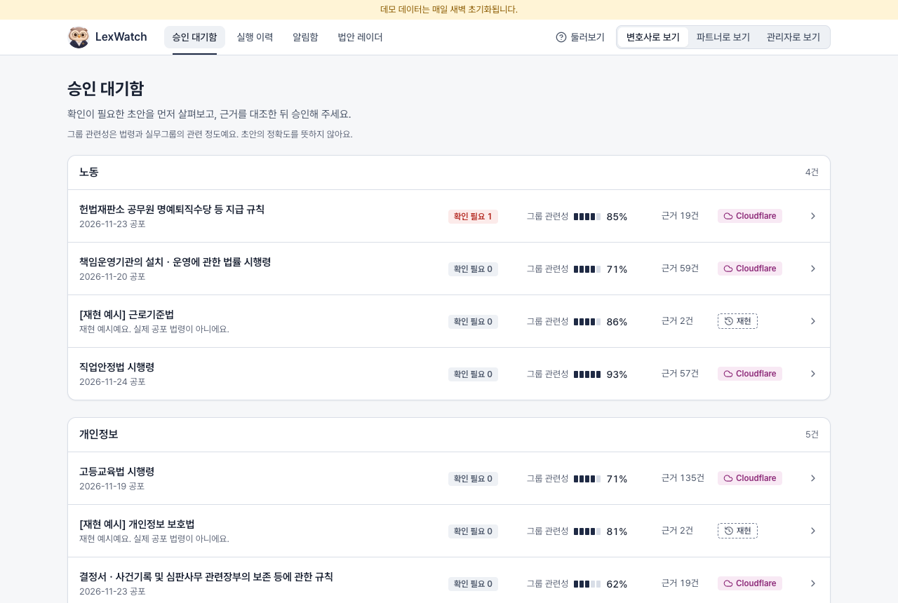
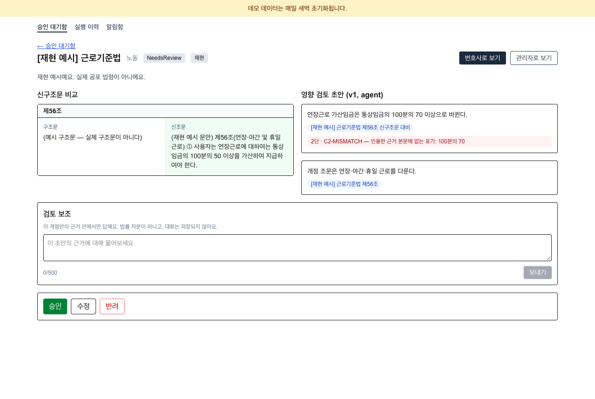

# LexWatch

공포된 법령 개정을 매일 수집해 실무그룹별 영향 검토 메모 초안을 만들고, 크리틱 3단이 검사한 뒤 변호사 역할 사용자가 승인해야 알림이 나가는 Workflow 데모입니다. 변호사의 판단을 대신하지 않고, 초안과 근거를 사람이 확인하는 단계를 중심에 둡니다.

- 데모 주소: `<배포 주소 — 배포 후 기입>` <!-- TODO(deploy) -->
- 상태: 배포 전입니다. 아래 화면은 로컬 docker compose에서 키 없이 띄운 것입니다.
- 키(`NVIDIA_API_KEY`, `LAW_OC`) 없이 만든 구현입니다. 실제 NVIDIA 모델 호출과 실제 법령 수집은 아직 한 번도 돌려 보지 않았습니다. 자세한 수준은 [NVIDIA 연동과 검증 수준](docs/nvidia-integration.md)에 있습니다.



## 왜 만들었나

대형 로펌은 법령 개정을 감시해 실무그룹별로 고객 안내(Legal Update)를 냅니다. 이 업무에는 사람이 하던 일이 여럿 섞여 있습니다. 개정을 찾고, 어느 그룹에 관련되는지 가리고, 조문을 대조해 초안을 쓰고, 틀린 곳이 없는지 확인하고, 책임자가 승인합니다.
이 데모는 그 흐름을 외부 API 호출, 여러 단계의 Workflow, 그 안의 AI Agent 한 단계, 실패 처리, 실행 이력으로 구현했습니다. 법인 문서가 외부로 나가지 않는 구조로 옮길 수 있도록 모델은 NVIDIA NIM 호환 인터페이스로 호출합니다.

## 평가자 3분 가이드

화면은 로그인 없이 우측 상단에서 "변호사로 보기"와 "관리자로 보기"를 고릅니다. 화면 상단에 "데모 데이터는 매일 새벽 초기화됩니다"가 표시됩니다.

1. **승인 대기함**(첫 화면): 실무그룹별 초안이 신뢰도, 근거 수, 크리틱 적발 수와 함께 나열됩니다. `재현` 배지가 붙은 항목은 녹화를 다시 재생한 예시이고 법령 이름 앞에 `[재현 예시]`가 붙습니다.
2. **초안 상세**: 왼쪽에 신구조문 비교, 오른쪽에 문장별 근거가 달린 초안이 있습니다. 크리틱이 걸린 문장은 사유가 붙습니다(노동 그룹 예시가 숫자 불일치 적발 사례입니다). 아래 검토 보조에 근거에 관해 질문할 수 있고, 근거 밖 질문은 거절됩니다. 승인, 수정, 반려가 가능하고 반려는 사유가 필요합니다.
3. **실행 이력**: 실행 하나를 열면 단계별 시간, 시도 횟수, 에이전트의 도구 호출 순서, 크리틱 판정이 시간순으로 이어집니다. 단계마다 정직성 배지가 있습니다.
4. **알림함**: 변호사 역할로 승인하면 해당 그룹의 안내문이 알림함에 생깁니다. 외부로 나가는 실제 발송은 없습니다.

| 초안 상세 | 실행 이력 |
|---|---|
|  |  |


## 아키텍처

```
GitHub Actions (수집 07:00 KST, 초기화 04:00 KST) --토큰--> .NET API (Render, 도커)
                                   |
                  +----------------+-----------------+
                  | Workflow 엔진 (.NET)             |
                  | 상태, 재시도, 이력, 승인          |
                  | 크리틱 1단, 2단                   |
                  +----+---------------------+-------+
                       |                     |
        국가법령정보센터 API         Python AI 서비스 (FastAPI, Vercel)
        (수집, 조문, 신구조문)       분류, 영향 분석 에이전트, 크리틱 3단, 검토 보조
                       |                     |
                       |             NVIDIA NIM (Nemotron, Retriever)
                   PostgreSQL + pgvector (Supabase)
                                   |
                       Next.js 화면 (Vercel)
```

- .NET이 Workflow 상태와 재시도 결정을 맡고, Python AI 서비스는 상태 없이 판단만 합니다.
- Workflow 엔진은 직접 만들었습니다. `FOR UPDATE SKIP LOCKED`로 대기 단계를 집어 여러 인스턴스에서도 한 단계가 두 번 돌지 않습니다.
- 영향 분석 에이전트는 프레임워크 없이 도구 호출 루프를 직접 짰습니다. 도구는 전부 읽기 전용이고 호출 8회, 120초 상한이 있습니다. 도구가 가져온 문서는 모두 근거 ID를 받고, 초안은 그 ID로만 인용할 수 있습니다.
- Python 클라이언트는 FastAPI의 OpenAPI 문서에서 생성해 계약이 어긋나면 빌드에서 걸립니다.
- 설계 문서: [docs/superpowers/specs/2026-11-16-lexwatch-design.md](docs/superpowers/specs/2026-11-16-lexwatch-design.md)

## Workflow와 실패 처리

한 번의 수집이 개정 건마다 실행 하나를 만들고, 관련 실무그룹마다 승인 단위(그룹 검토)가 생깁니다.

| 단계 | 하는 일 | 실패 처리 |
|---|---|---|
| 1. 수집 | 기간 내 공포 법령 목록 조회, 원문 저장 | 지수 백오프 3회. 결과 0건이 사흘 이어지면 이상 신호 |
| 2. 중복 제거 | 법령 ID, 공포일, 시행일로 멱등 키 | |
| 3. 조문 확보 | 신구조문 또는 현행 조문과 개정 조문을 근거 저장소에 조문 단위로 저장 | 3회 재시도 후 실행 `failed`, 관리자 화면에서 다시 실행 |
| 4. 분류 | 그룹별 관련성과 신뢰도 | 429는 재시도 시각 뒤 재시도. 422는 1회 재시도 후 `needs_review` |
| 5. 영향 분석 | 관련 그룹마다 에이전트가 초안 작성 | 120초 타임아웃. 근거 부족이면 초안 없이 `needs_review` |
| 6. 크리틱 1단 | 인용 근거 ID가 근거 저장소에 있는가, 문장마다 인용이 있는가 | 표시 후 `needs_review` |
| 7. 크리틱 2단 | 조문번호, 날짜, 숫자가 원문과 맞는가 | 표시 후 `needs_review` |
| 8. 크리틱 3단 | 결론이 근거를 넘었는가(과잉해석) | 규칙 ID와 문장 표시 후 `needs_review` |
| 9. 승인 대기 | 승인, 수정 후 승인, 반려. 승인자와 수정 전후를 기록 | |
| 10. 알림 | 승인된 그룹의 안내를 데모 알림함으로 발송 | 3회 재시도. 발송 실패가 승인을 되돌리지 않음 |

분류 신뢰도가 높으면 다음 단계로, 중간이면 분석하되 검토 필요로 표시하고, 낮으면 그 그룹을 "관련 없음"으로 닫고 이유를 남깁니다. 실행은 모든 그룹이 끝나면 `completed`가 됩니다.

## 크리틱 3단과 평가

| 단 | 보는 것 | 모델 |
|---|---|---|
| 1단 결정 규칙 (.NET) | 문장마다 인용이 있고 인용 ID가 근거 저장소에 있는지 | 쓰지 않음 |
| 2단 원문 대조 (.NET) | 조문번호, 시행일, 공포일, 기간과 금액 숫자가 원문과 맞는지 | 쓰지 않음 |
| 3단 과잉해석 판정 (Python) | 근거와 숫자가 맞아도 결론이 근거를 넘었는지 | Nemotron, 여기서만 |

과잉해석 규칙은 다섯 개입니다. OC-01 경과규정 없이 시행일 이전 계약에 적용된다고 단정, OC-02 하위법령이 없는 위임 조항을 구체적 의무로 기술, OC-03 판례 하나를 일반 원칙처럼 기술, OC-04 "반드시", "모든"으로 범위 확장, OC-05 벌칙과 과태료 금액을 개정 전 조문에서 인용.

**평가 수치** (`eval/critic_cases.jsonl` 16건: 과잉해석 10, 정상 6. 결과는 `eval/results/`):

| 모드 | 적발 | 규칙 ID 정확 | 거짓 양성 |
|---|---|---|---|
| 규칙 있음 (패턴 대체 구현) | 10 / 10 | 10 / 10 | 정상 6건 중 0건 |
| 규칙 없이 모델만 | 실모델 평가 전, 키 확보 후 측정 예정 | | |

이 수치를 읽는 방법을 정직하게 적습니다.

- 위 수치는 NVIDIA 모델이 아니라 키 없을 때 도는 **패턴 대체 구현**에서 나왔습니다. 모델 정확도가 아닙니다.
- 케이스와 패턴을 같은 사람이 같은 날 썼으므로 맞춰 쓴 결과입니다. 일반화 성능을 뜻하지 않습니다.
- 케이스의 조문은 예시값(placeholder)입니다. 실제 법령 녹화본으로 바꾼 뒤 다시 돌릴 예정입니다.
- "규칙 없이 모델만" 모드는 키 없이는 같은 패턴 판정이 돌아 비교가 성립하지 않아 수치를 적지 않습니다(결과 파일에 `comparison_valid: false`).
- 과잉해석 케이스 10건은 모두 한 문장짜리입니다. 여러 문장으로 된 초안에서 문장 위치를 맞히는 케이스는 앞으로 추가합니다.

## NVIDIA 연동과 검증 수준

| 연동 | 수준 |
|---|---|
| NIM 채팅 (Nemotron) | 녹화 테스트 |
| 임베딩과 리랭커 (NeMo Retriever) | 녹화 테스트 |
| NeMo Guardrails | 문서만 (실제로 도는 것은 결정적 입력 규칙) |
| 사내 NIM 배포 | 문서만 |

- **실행 검증**: 실제 엔드포인트를 호출해 확인함. 현재 0건입니다.
- **녹화 테스트**: 재구성한 응답이나 가짜 전송 계층으로 우리 코드의 처리를 확인함. 실제 서버가 그렇게 답하는지는 확인하지 않았습니다.
- **문서만**: 절차나 설정을 적기만 했음.

화면 배지는 NVIDIA(초록), 대체 구현(주황), 재현(회색)으로 구분하며 대체 구현을 NVIDIA라고 표시하지 않습니다. 근거와 한계는 [docs/nvidia-integration.md](docs/nvidia-integration.md), 사내 배포 절차는 [docs/on-prem-nim.md](docs/on-prem-nim.md)(실행 검증하지 않음)에 있습니다.

## 하지 않은 것과 향후 계획

- 입법예고 수집: 출처 API가 다르고 본문이 첨부 파일(HWP, PDF)이라 근거 대조가 성립하지 않아 뺐습니다. 향후 계획입니다.
- 사내 NIM 실배포: 문서만 있고 실행하지 않았습니다.
- OpenShell로 에이전트의 아웃바운드를 제한하는 구성: 하지 않았습니다.
- 실제 법령 수집과 실모델 평가: 키를 받은 뒤 `scripts/record_lawapi.py`, `scripts/try_nemotron_ko.py`, `make eval-critic`으로 수행할 예정입니다.
- 판례 전문 검색, 범용 법률 챗봇, 실제 사건이나 의뢰인 데이터, 회원 체계는 범위 밖입니다.

## 출처

- ReRoute (NVIDIA Korea Agentic AI Hackathon 본선 진출 10팀 중 하나, 팀 저장소): NIM 어댑터의 재시도와 `Retry-After` 처리, 텍스트 도구 호출 파싱, 에이전트 가드레일 방식을 참고했습니다.
- FlyGate (팀 저장소): 크리틱 3단 설계를 참고했습니다. 법률 도메인에 맞게 새로 구현했고 코드는 옮기지 않았습니다.
- 법령 데이터는 국가법령정보센터 Open API를 쓰도록 구현했습니다.

## 로컬 실행

키 없이 전체가 뜹니다. LLM은 대체 구현, 검색은 lexical, 재현 실행이 시드됩니다.

```bash
docker compose up --build          # http://localhost:3000, API http://localhost:5080
docker compose down                # 데이터 볼륨까지 지우려면 -v
```

- 구형 Docker(20.10)라면 `export DOCKER_API_VERSION=1.41`이 필요할 수 있습니다. 이미지 조회가 멈추면 빈 `DOCKER_CONFIG` 디렉터리를 지정합니다([docs/deploy.md](docs/deploy.md) 참고).
- 실제 키를 쓰려면 저장소 루트 `.env`에 `NVIDIA_API_KEY`, `LAW_OC`를 적습니다(커밋하지 않습니다. 이름은 `.env.example` 참고).

테스트:

```bash
cd ai && uv run pytest                      # AI 서비스 69건
cd web && pnpm test                         # 화면 23건
export DOTNET_ROOT=$HOME/.dotnet PATH=$HOME/.dotnet:$PATH
make test-backend                           # .NET 118건, Testcontainers라 Docker 필요
make eval-critic                            # 크리틱 평가, 결과를 eval/results에 저장
```

배포는 [docs/deploy.md](docs/deploy.md)에 적었으나 계정이 필요한 단계는 아직 실행하지 않았습니다.
