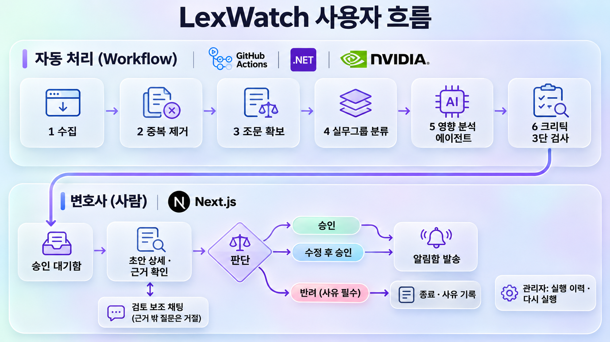
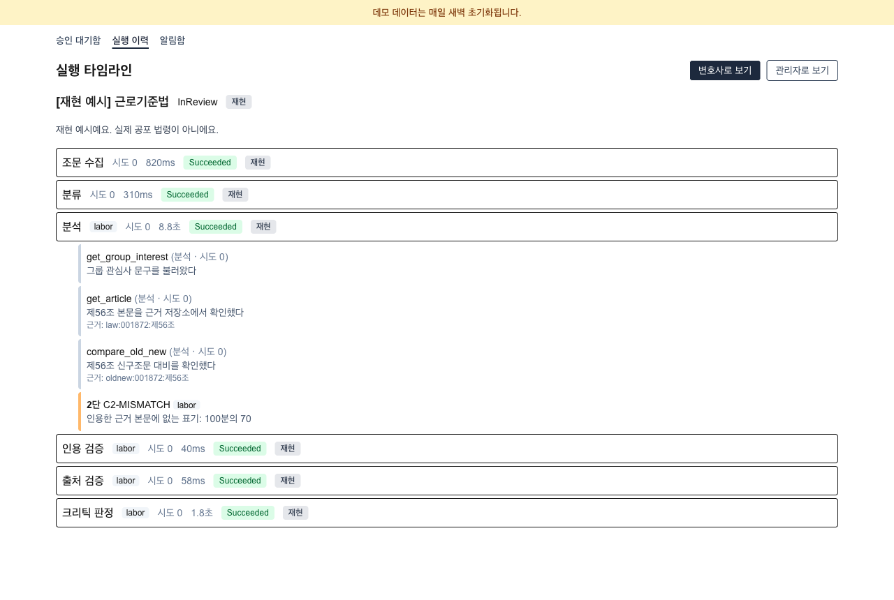
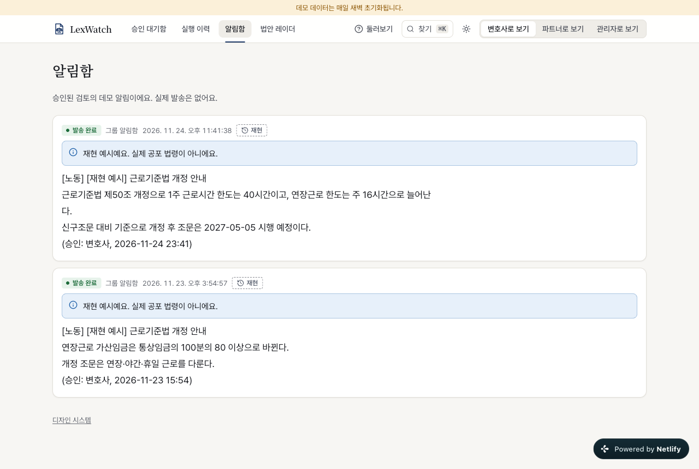
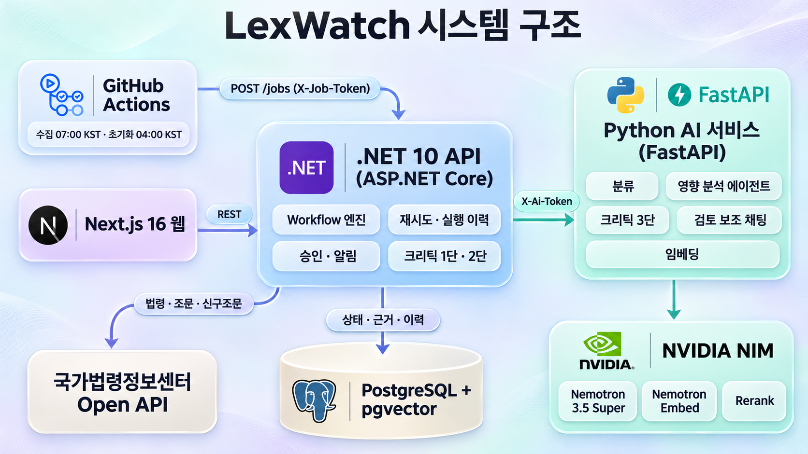
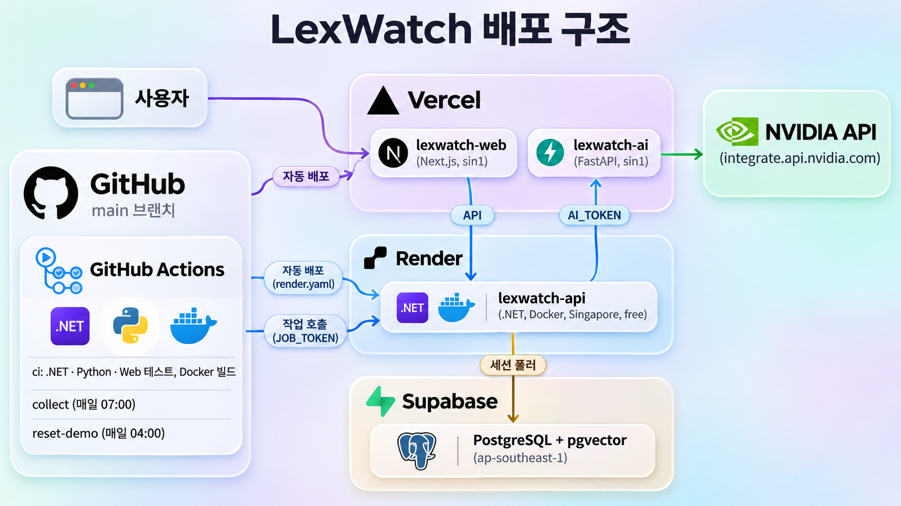

<h1 align="center">LexWatch</h1>
<h3 align="center">법령 개정을 매일 읽고, 변호사가 확인할 초안을 먼저 써 두는 Workflow</h3>

<p align="center">
  <a href="https://lexwatch-web.vercel.app">데모 바로가기</a> ·
  <a href="docs/deploy.md">배포 런북</a> ·
  <a href="docs/nvidia-integration.md">NVIDIA 연동 기록</a> ·
  <a href="docs/superpowers/specs/2026-11-16-lexwatch-design.md">설계 문서</a>
</p>


> 무료 서버라 첫 접속은 1분쯤 걸릴 수 있습니다. 2026-11-16에 배포했고, 키 없이 mock과 재현 데이터로 동작합니다. 위 화면은 로컬 docker compose에서 키 없이 띄운 것입니다.

<br>

## 📝 LexWatch는 어떤 서비스인가요?

공포된 법령 개정을 매일 수집해 실무그룹별 영향 검토 메모 초안을 만들고, 크리틱 3단이 검사한 뒤 변호사 역할 사용자가 승인해야 알림이 나가는 Workflow 데모입니다. 변호사의 판단을 대신하지 않고, 초안과 근거를 사람이 확인하는 단계를 중심에 둡니다.

### 만든 이유

대형 로펌은 법령 개정을 감시해 실무그룹별로 고객 안내(Legal Update)를 냅니다. 이 업무에는 사람이 하던 일이 여럿 섞여 있습니다. 개정을 찾고, 어느 그룹에 관련되는지 가리고, 조문을 대조해 초안을 쓰고, 틀린 곳이 없는지 확인하고, 책임자가 승인합니다.

이 데모는 그 흐름을 외부 API 호출, 여러 단계의 Workflow, 그 안의 AI Agent 한 단계, 실패 처리, 실행 이력으로 구현했습니다. 법인 문서가 외부로 나가지 않는 구조로 옮길 수 있도록 모델은 NVIDIA NIM 호환 인터페이스로 호출합니다.

<br>

## 🔁 핵심 흐름

| 1. 수집 | 2. 분류·분석 | 3. 검사 | 4. 승인·알림 |
| --- | --- | --- | --- |
| 국가법령정보센터에서 공포된 개정과 신구조문을 가져옵니다. | 실무그룹별 관련성을 가리고, 에이전트가 근거를 인용한 초안을 씁니다. | 인용, 숫자와 날짜, 과잉해석을 세 단계로 검사합니다. | 변호사가 승인하거나 고쳐서 승인해야 그룹 알림함으로 나갑니다. |



<br>

## 🖥️ 주요 화면

| 승인 대기함 | 초안 상세 |
| :---: | :---: |
|  |  |
| 실무그룹별 초안을 신뢰도, 근거 수, 크리틱 적발 수와 함께 나열합니다. | 신구조문 비교와 문장별 근거가 달린 초안, 검토 보조 채팅이 한 화면에 있습니다. |
| **실행 이력** | **알림함** |
|  |  |
| 단계별 시간, 시도 횟수, 도구 호출 순서, 크리틱 판정을 시간순으로 보여 줍니다. | 승인된 그룹의 안내문이 도착합니다. 외부로 나가는 실제 발송은 없습니다. |

### 평가자 3분 가이드

화면은 로그인 없이 우측 상단에서 "변호사로 보기"와 "관리자로 보기"를 고릅니다. 화면 상단에 "데모 데이터는 매일 새벽 초기화됩니다"가 표시됩니다. 초기화는 재현 예시와 채팅 할당량만 다시 만들고, 실제 수집 실행의 결정과 크리틱 판정은 그대로 둡니다.

1. **승인 대기함**(첫 화면): `재현` 배지가 붙은 항목은 녹화를 다시 재생한 예시이고 법령 이름 앞에 `[재현 예시]`가 붙습니다.
2. **초안 상세**: 크리틱이 걸린 문장에는 사유가 붙습니다(노동 그룹 예시가 숫자 불일치 적발 사례입니다). 검토 보조에 근거에 관해 질문할 수 있고, 근거 밖 질문은 거절됩니다. 승인, 수정, 반려가 가능하고 반려는 사유가 필요합니다.
3. **실행 이력**: 실행 하나를 열면 단계마다 정직성 배지가 있습니다. 관리자 역할로는 실패한 실행을 다시 돌릴 수 있습니다.
4. **알림함**: 변호사 역할로 승인하면 해당 그룹의 안내문이 생깁니다.

<br>

## ✅ 현재 구현

| 영역 | 제공 기능 |
| --- | --- |
| 수집 | 국가법령정보센터 Open API 조회, 법령 ID·공포일·시행일 멱등 키, 원문과 조문 단위 근거 저장 |
| Workflow | 직접 만든 단계 엔진, `FOR UPDATE SKIP LOCKED` 단계 점유, 지수 백오프 재시도, 단계별 실행 이력 |
| AI | 실무그룹 분류, 도구 호출 루프로 짠 영향 분석 에이전트(읽기 전용 도구, 8회·120초 상한), 임베딩 |
| 검사 | 크리틱 1단(인용 규칙), 2단(조문번호·날짜·숫자 대조), 3단(과잉해석 규칙 OC-01~05) |
| 검토 | 승인·수정 후 승인·반려, 승인자와 수정 전후 기록, 근거 안에서만 답하는 검토 보조 채팅 |
| 알림 | 승인된 그룹의 데모 알림함 발송, 실패 시 관리자 알림과 알림만 다시 실행 |
| 운영 | 매일 07:00 수집, 04:00 데모 초기화(GitHub Actions), 채팅 할당량, 공유 토큰으로 AI 서비스 보호 |
| 화면 | 로펌 직원용 디자인 시스템: 의미 토큰과 WCAG 2.2 AA 대비 검사, 한국어 상태 라벨, 법제처 공식 변경 표시를 쓴 신구조문 대조, 인용 근거 팝오버, 승인 확인 대화상자, 마스코트 "렉스". 규칙은 앱의 `/design-system` 화면과 [설계 문서](docs/features/design-system/design.md)에 있습니다 |

<br>

## 🛠️ 기술 구성

| 영역 | 기술 |
| --- | --- |
| Web | Next.js 16, React 19, TypeScript, Tailwind CSS 4, Base UI, Pretendard |
| API | .NET 10, ASP.NET Core Minimal API, EF Core 10, Npgsql, Serilog, OpenTelemetry |
| AI | Python 3.12, FastAPI, Pydantic, httpx, uv |
| Model | NVIDIA NIM: Nemotron 3.5 Super VL(채팅), Nemotron Embed(임베딩), Nemotron Rerank |
| Data | PostgreSQL, pgvector (Supabase) |
| Test | xUnit, Testcontainers, pytest, Vitest |
| Delivery | GitHub Actions, Docker, Vercel, Render |

<br>

## 🏗️ 아키텍처

### 시스템 구조



- .NET이 Workflow 상태와 재시도 결정을 맡고, Python AI 서비스는 상태 없이 판단만 합니다.
- Workflow 엔진은 직접 만들었습니다. `FOR UPDATE SKIP LOCKED`로 대기 단계를 집어 여러 인스턴스에서도 한 단계가 두 번 돌지 않습니다.
- 영향 분석 에이전트는 프레임워크 없이 도구 호출 루프를 직접 짰습니다. 도구는 전부 읽기 전용입니다. 도구가 가져온 문서는 모두 근거 ID를 받고, 초안은 그 ID로만 인용할 수 있습니다.
- Python AI 서비스는 .NET API만 부를 수 있습니다. 공유 토큰 헤더(`X-Ai-Token`)가 없으면 `/health` 말고는 401이고, 토큰을 건 배포에서는 API 문서 경로도 닫습니다. 공개 데모의 채팅 할당량과 키를 우회하지 못하게 하려는 것입니다.
- .NET의 AI 클라이언트는 FastAPI의 OpenAPI 문서에서 생성합니다(`scripts/gen-ai-client.sh`). CI가 다시 생성해 커밋과 다르면 실패하므로 계약이 어긋나면 빌드에서 걸립니다.

### 배포 구조



| 구성 | 위치 | 배포 방식 |
| --- | --- | --- |
| 웹 (`lexwatch-web`) | Vercel, sin1 | `main` push 시 자동 배포, Root Directory `web` |
| AI 서비스 (`lexwatch-ai`) | Vercel, sin1, Fluid Compute | `main` push 시 자동 배포, Root Directory `ai` |
| API (`lexwatch-api`) | Render free, Singapore, Docker | `render.yaml` 블루프린트. `main`에서 CI가 모두 통과하면 `ci`의 `deploy-api` 잡이 배포 |
| DB | Supabase PostgreSQL + pgvector, ap-southeast-1 | 세션 풀러로 연결, API 기동 시 마이그레이션 |

### CI/CD

| 워크플로 | 시점 | 하는 일 |
| --- | --- | --- |
| `ci` | push, PR | .NET 테스트, Python 테스트, AI 클라이언트 재생성 비교, 웹 타입체크·린트·테스트·빌드, 이미지 3종 빌드. `main` push에서 모두 통과하면 Render API 배포 후 `/health`의 커밋으로 확인 |
| `collect` | 매일 07:00 KST | 잠든 무료 서버를 깨우고 `POST /jobs/collect`, 처리하는 10분 동안 `/health` 호출 |
| `reset-demo` | 매일 04:00 KST | `POST /jobs/reset-demo`로 재현 예시와 채팅 할당량 재생성 |

예약 워크플로는 저장소의 기본 브랜치(`main`)에서만 돕니다. 토큰 교체와 수동 배포 절차는 [배포 런북](docs/deploy.md)에 있습니다.

<br>

## 🔧 Workflow와 실패 처리

한 번의 수집이 개정 건마다 실행 하나를 만들고, 관련 실무그룹마다 승인 단위(그룹 검토)가 생깁니다.

| 단계 | 하는 일 | 실패 처리 |
|---|---|---|
| 1. 수집 | 기간 내 공포 법령 목록 조회, 원문 저장 | 지수 백오프 3회. 결과 0건이 사흘 이어지면 이상 신호 |
| 2. 중복 제거 | 법령 ID, 공포일, 시행일로 멱등 키 | |
| 3. 조문 확보 | 신구조문 또는 현행 조문과 개정 조문을 근거 저장소에 조문 단위로 저장 | 3회 재시도 후 실행 `failed`, 관리자 화면에서 다시 실행 |
| 4. 분류 | 그룹별 관련성과 신뢰도 | 429는 재시도 시각 뒤 재시도. 422는 1회 재시도 후에도 실패하면 표시할 그룹이 없으므로 실행 `failed`(오류 코드 `LLM_OUTPUT_INVALID`), 관리자 화면에서 다시 실행 |
| 5. 영향 분석 | 관련 그룹마다 에이전트가 초안 작성 | 120초 타임아웃. 근거 부족이면 초안 없이 `needs_review`(초안이 없으면 승인·수정은 못 하고 반려만 할 수 있음) |
| 6. 크리틱 1단 | 인용 근거 ID가 근거 저장소에 있는가, 문장마다 인용이 있는가 | 표시 후 `needs_review` |
| 7. 크리틱 2단 | 조문번호, 날짜, 숫자가 원문과 맞는가 | 표시 후 `needs_review` |
| 8. 크리틱 3단 | 결론이 근거를 넘었는가(과잉해석) | 규칙 ID와 문장 표시 후 `needs_review` |
| 9. 승인 대기 | 승인, 수정 후 승인, 반려. 승인자와 수정 전후를 기록 | |
| 10. 알림 | 승인된 그룹의 안내를 데모 알림함으로 발송 | 3회 재시도. 실패하면 관리자 알림을 남기고 실행 `failed`. 발송 실패가 승인을 되돌리지 않으며 관리자 화면에서 알림만 다시 실행 |

분류 신뢰도가 높으면 다음 단계로, 중간이면 분석하되 검토 필요로 표시하고, 낮으면 그 그룹을 "관련 없음"으로 닫고 이유를 남깁니다. 실행은 모든 그룹이 끝나면 `completed`가 됩니다.

<br>

## 🔍 크리틱 3단과 평가

| 단 | 보는 것 | 모델 |
|---|---|---|
| 1단 결정 규칙 (.NET) | 문장마다 인용이 있고 인용 ID가 근거 저장소에 있는지 | 쓰지 않음 |
| 2단 원문 대조 (.NET) | 조문번호, 시행일, 공포일, 기간과 금액 숫자가 원문과 맞는지 | 쓰지 않음 |
| 3단 과잉해석 판정 (Python) | 근거와 숫자가 맞아도 결론이 근거를 넘었는지 | Nemotron, 여기서만 |

과잉해석 규칙은 다섯 개입니다. OC-01 경과규정 없이 시행일 이전 계약에 적용된다고 단정, OC-02 하위법령이 없는 위임 조항을 구체적 의무로 기술, OC-03 판례 하나를 일반 원칙처럼 기술, OC-04 "반드시", "모든"으로 범위 확장, OC-05 벌칙과 과태료 금액을 개정 전 조문에서 인용.

**평가 수치** (`eval/critic_cases.jsonl` 16건: 과잉해석 10, 정상 6. 결과는 `eval/results/`):

| 모드 | 적발 | 규칙 ID 정확 | 거짓 양성 |
|---|---|---|---|
| 규칙 있음 (패턴 대체 구현) | 10 / 10 | 10 / 10 | 정상 6건 중 0건 |
| 규칙 있음 (NVIDIA 실호출) | 10 / 10 | 10 / 10 | 정상 6건 중 0건 |
| 규칙 없이 모델만 (NVIDIA 실호출) | 10 / 10 | 해당 없음 | 정상 6건 중 1건 |

이 수치를 읽는 방법을 정직하게 적습니다.

- NVIDIA 결과는 Nemotron 3.5 Super VL로 실행했습니다. [규칙 있음](eval/results/critic_rules_nvidia-nim_2026-11-17.json)과 [규칙 없음](eval/results/critic_norules_nvidia-nim_2026-11-17.json)에 케이스별 판정을 기록했습니다.
- 케이스와 패턴을 같은 사람이 같은 날 썼으므로 맞춰 쓴 결과입니다. 일반화 성능을 뜻하지 않습니다.
- 케이스의 조문은 예시값(placeholder)입니다. 실제 법령 녹화본으로 바꾼 뒤 다시 돌릴 예정입니다.
- 키 없이 실행하면 두 모드 모두 같은 패턴으로 판정합니다(결과 파일에 `comparison_valid: false`).
- 과잉해석 케이스 10건은 모두 한 문장짜리입니다. 여러 문장으로 된 초안에서 문장 위치를 맞히는 케이스는 앞으로 추가합니다.

<br>

## 🟢 NVIDIA 연동과 검증 수준

로컬에서 NVIDIA 실호출을 검증했습니다. 분류와 초안, 크리틱은 합성 예시로 확인했습니다. 국가법령정보센터 실수집은 보류했습니다.

| 연동 | 수준 |
|---|---|
| NIM 채팅 (Nemotron) | 실행 검증 |
| 임베딩 (Nemotron Embed) | 실행 검증, 2,048차원 |
| 리랭커 (Nemotron Rerank) | 녹화 테스트 |
| NeMo Guardrails | 문서만 (실제로 도는 것은 결정적 입력 규칙) |
| 사내 NIM 배포 | 문서만 |

- **실행 검증**: 실제 엔드포인트를 호출해 응답을 확인함.
- **녹화 테스트**: 재구성한 응답이나 가짜 전송 계층으로 우리 코드의 처리를 확인함. 실제 서버가 그렇게 답하는지는 확인하지 않았습니다.
- **문서만**: 절차나 설정을 적기만 했음.

화면의 출처 라벨은 NVIDIA(보라), 대체 구현(남회색), 재현(점선 테두리)으로 구분하며 대체 구현을 NVIDIA라고 표시하지 않습니다. 출처는 품질 판정이 아니어서 성공과 실패를 뜻하는 초록과 빨강을 쓰지 않습니다. 근거와 한계는 [docs/nvidia-integration.md](docs/nvidia-integration.md), 사내 배포 절차는 [docs/on-prem-nim.md](docs/on-prem-nim.md)(실행 검증하지 않음)에 있습니다.

<br>

## 🚀 로컬에서 시작하기

### 준비물

- Docker (compose v2)
- 테스트까지 돌리려면 .NET SDK 10, uv, pnpm

### 실행

키 없이 전체가 뜹니다. LLM은 대체 구현, 검색은 lexical, 재현 실행이 시드됩니다.

```bash
docker compose up --build          # 데이터 볼륨까지 지우려면 docker compose down -v
```

| 주소 | 용도 |
| --- | --- |
| `http://localhost:3000` | 웹 |
| `http://localhost:5080` | .NET API |

- 구형 Docker(20.10)라면 `export DOCKER_API_VERSION=1.41`이 필요할 수 있습니다. 이미지 조회가 멈추면 빈 `DOCKER_CONFIG` 디렉터리를 지정합니다([docs/deploy.md](docs/deploy.md) 참고).
- 실제 키를 쓰려면 저장소 루트 `.env`에 `NVIDIA_API_KEY`, `LAW_OC`를 적습니다(커밋하지 않습니다. 이름과 기본 모델은 `.env.example` 참고).

### 테스트

```bash
cd ai && uv run pytest                      # AI 서비스 77건
cd web && pnpm test                         # 화면 85건(토큰 대비, 라벨, 신구 대조 포함)
export DOTNET_ROOT=$HOME/.dotnet PATH=$HOME/.dotnet:$PATH
make test-backend                           # .NET 141건, Testcontainers라 Docker 필요
make eval-critic                            # 크리틱 평가, 결과를 eval/results에 저장
```

### 디렉터리 구조

```
lexwatch/
├── backend/    .NET 10 API, Workflow 엔진, 크리틱 1·2단
├── ai/         FastAPI AI 서비스, 분류·에이전트·크리틱 3단·검토 보조
├── web/        Next.js 화면
├── eval/       크리틱 평가 케이스와 결과
├── fixtures/   녹화한 외부 응답과 재현 데이터
├── scripts/    클라이언트 생성, 평가, 법령 API 녹화
└── docs/       배포 런북, NVIDIA 연동 기록, 설계·계획 문서
```

<br>

## 🚧 하지 않은 것과 향후 계획

- 입법예고 수집: 출처 API가 다르고 본문이 첨부 파일(HWP, PDF)이라 근거 대조가 성립하지 않아 뺐습니다. 향후 계획입니다.
- 사내 NIM 실배포: 문서만 있고 실행하지 않았습니다.
- OpenShell로 에이전트의 아웃바운드를 제한하는 구성: 하지 않았습니다.
- 실제 법령 수집과 실데이터 기반 평가: 수집 재개 후 `scripts/record_lawapi.py`로 응답을 녹화하고 실제 조문으로 평가를 다시 실행할 예정입니다.
- 판례 전문 검색, 범용 법률 챗봇, 실제 사건이나 의뢰인 데이터, 회원 체계는 범위 밖입니다.

<br>

## 📚 출처

- ReRoute (NVIDIA Korea Agentic AI Hackathon 본선 진출 10팀 중 하나, 팀 저장소): NIM 어댑터의 재시도와 `Retry-After` 처리, 텍스트 도구 호출 파싱, 에이전트 가드레일 방식을 참고했습니다.
- FlyGate (팀 저장소): 크리틱 3단 설계를 참고했습니다. 법률 도메인에 맞게 새로 구현했고 코드는 옮기지 않았습니다.
- 법령 데이터는 국가법령정보센터 Open API를 쓰도록 구현했습니다.
- README의 구조도 세 장(`docs/images/`)과 마스코트 "렉스"(`web/public/mascot/`)는 Codex CLI 내장 이미지 생성으로 만들었습니다. 마스코트 프롬프트는 [assets.md](docs/features/design-system/assets.md)에 있습니다.
- 디자인 시스템은 IBM Carbon, GOV.UK, Atlassian, KRDS의 공개 지침을 참고했습니다([조사 기록](docs/features/design-system/research.md)).

<br>

## 👤 만든 사람

| [hyunolike](https://github.com/hyunolike) |
| :---: |
| <a href="https://github.com/hyunolike"></a> |
| Backend · AI · Web |
