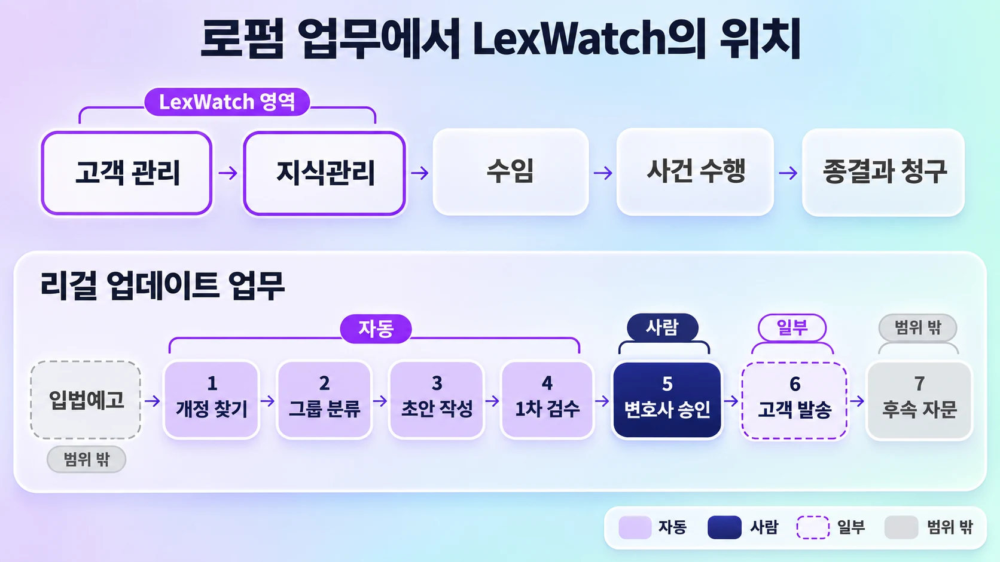
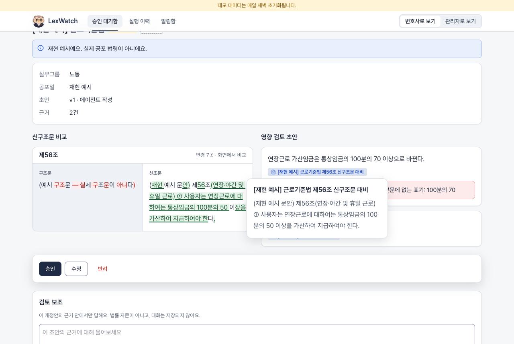
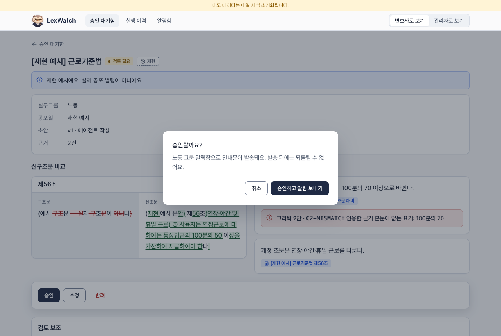
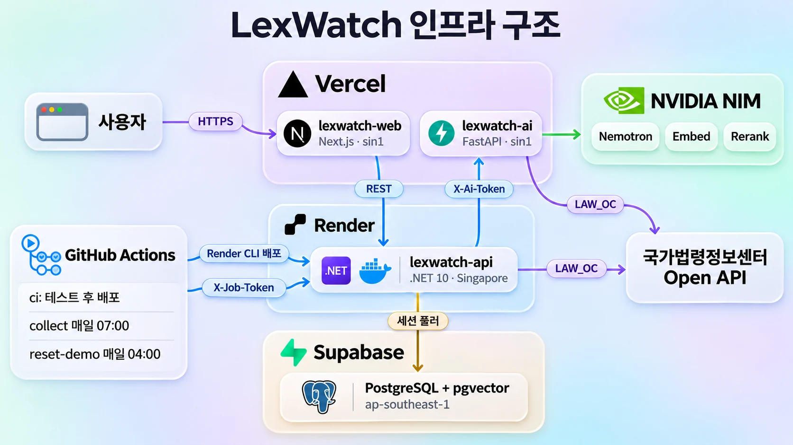
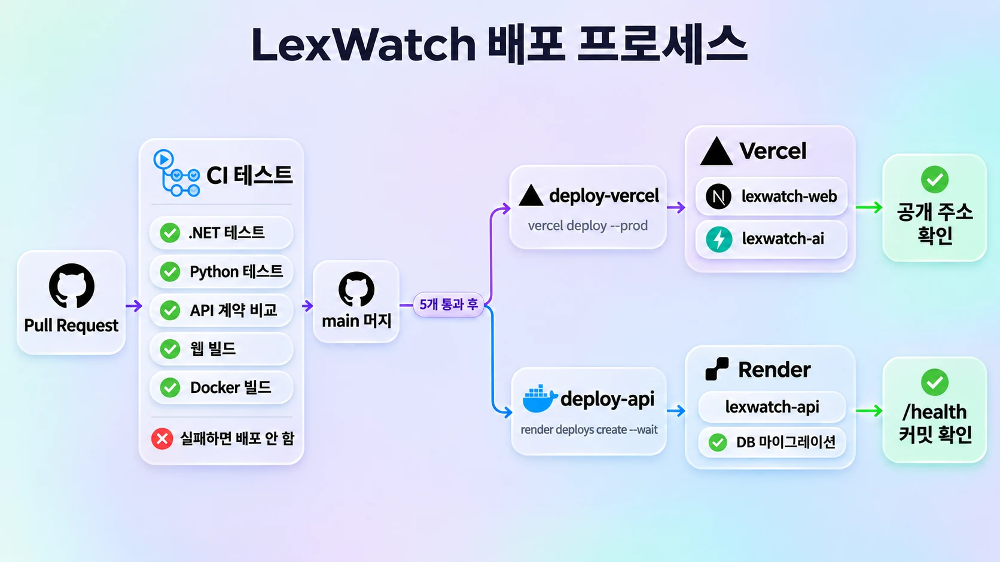
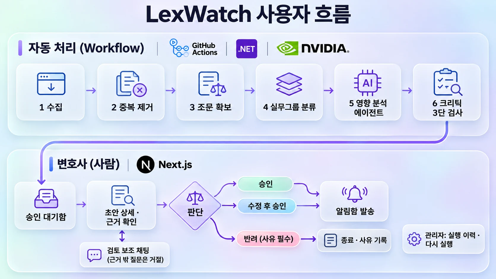
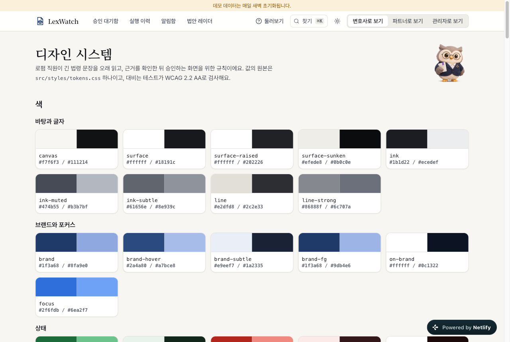

<p align="center">
  
</p>

<p align="center">
  <a href="https://lexwatch-web.vercel.app"><b>🔗 LexWatch 바로가기</b></a>
  &nbsp;|&nbsp;
  <a href="docs/deploy.md">배포 런북</a>
  &nbsp;|&nbsp;
  <a href="docs/superpowers/specs/2026-11-16-lexwatch-design.md">설계 문서</a>
  &nbsp;|&nbsp;
  <a href="docs/features/design-system/design.md">디자인 시스템</a>
</p>

> 무료 서버라 첫 접속은 1분쯤 걸릴 수 있습니다. 서버가 깨어나는 동안 마스코트 렉스가 기다려 줍니다.

<br>

## 📝 기획 목적

대형 로펌은 법령 개정을 지켜보다가 실무그룹별로 고객 안내(Legal Update)를 냅니다. 이 일에는 사람이 하던 단계가 여럿 섞여 있습니다. 공포된 개정을 찾고, 어느 그룹과 관련되는지 가리고, 바뀐 조문을 대조해 초안을 쓰고, 틀린 곳이 없는지 검사하고, 책임 변호사가 승인합니다.

**LexWatch는 이 중 사람이 꼭 판단해야 하는 승인만 남기고 나머지를 Workflow로 미리 해 두는 서비스입니다.** 매일 아침 공포된 개정을 수집해 실무그룹별 영향 검토 초안을 만들고, 크리틱 3단이 검사한 뒤, 변호사가 근거를 확인하고 승인해야 알림이 나갑니다. 변호사의 판단을 대신하지 않고, 판단에 필요한 초안과 근거를 먼저 준비해 둡니다.

<br>

## 🎯 문제 정의 & 솔루션

### 🙋 이런 분들을 위해 만들었어요

1. 매일 공포되는 법령 개정을 일일이 찾아 담당 그룹을 가리는 데 시간을 씁니다.
2. 구조문과 신조문을 나란히 놓고 바뀐 글자를 눈으로 찾습니다.
3. AI가 쓴 초안을 받아도 어디까지 믿어도 되는지, 근거가 정말 있는지 다시 확인해야 합니다.
4. 실수로 승인 버튼을 눌러 안내가 나가 버릴까 걱정합니다.

### 💡 LexWatch가 이렇게 도와드려요

1. 매일 07:00에 국가법령정보센터에서 공포된 개정을 가져와 노동, 개인정보, 금융 그룹별로 나눕니다.
2. 법제처가 표시한 변경 부분을 그대로 받아 신구조문에서 바뀐 글자만 강조합니다.
3. 초안의 모든 문장은 근거를 인용하고, 인용을 누르면 근거 원문이 바로 뜹니다. 크리틱 3단이 인용, 숫자와 날짜, 과잉해석을 검사해 걸린 문장에 사유를 붙입니다.
4. 각 단계를 NVIDIA 모델이 처리했는지, 대체 구현이 처리했는지, 녹화한 데모인지 라벨로 숨김없이 보여 줍니다.
5. 승인 전에는 어느 그룹으로 안내가 나가는지 한 번 더 확인합니다.

<br>

## 🏛️ 로펌 업무에서의 위치



LexWatch는 사건을 처리하는 본업이 아니라 **법령 개정을 지켜보다 고객에게 알리는 리걸 업데이트 업무**에 속합니다. 수임료를 직접 받는 일은 아니지만, 고객과 접점을 유지하고 다음 자문으로 이어지게 하는 일이라 보통 지식관리팀, 실무그룹 변호사, 마케팅팀이 함께 맡습니다.

| 순서 | 실제 업무 | 보통 맡는 사람 | LexWatch |
|---|---|---|---|
| 1 | 공포된 개정 찾기 | 지식관리팀, 패러리걸 | 자동 (매일 07:00 수집) |
| 2 | 어느 실무그룹과 관련되는지 가리기 | 지식관리 변호사 | 자동 (분류와 신뢰도) |
| 3 | 신구조문 대조, 영향 분석 초안 작성 | 주니어 변호사 | 자동 (에이전트 초안) |
| 4 | 인용, 숫자, 과잉해석 검수 | 시니어 변호사 | 자동 1차 검수 (크리틱 3단) |
| 5 | 최종 검토와 승인 | 실무그룹 파트너 | **사람** (승인, 수정, 반려) |
| 6 | 고객별 발송, 홈페이지 게시 | 마케팅팀 | 일부 (데모 알림함까지) |
| 7 | 고객 문의 대응, 후속 자문 | 담당 변호사 | 범위 밖 |

1~4단계의 찾기, 나누기, 대조하기, 초안 쓰기를 덜어 주고, 법적 판단의 책임이 걸린 5단계 승인은 일부러 사람에게 남겼습니다. 입법예고와 국회 계류 법안 추적, 고객 명단과 엮은 실제 발송과 후속 자문 연결은 아직 다루지 않습니다. 단계 구분은 대형 로펌의 일반적인 업무 관행을 바탕으로 정리했으며 로펌마다 다를 수 있습니다.

<br>

## ✨ 핵심 기능

| 승인 대기함 | 초안 상세 |
| :---: | :---: |
|  |  |
| 실무그룹별 초안을 모아 크리틱 적발이 있는 초안을 먼저 보여 줍니다. 신뢰도는 숫자와 막대로 봅니다. | 신구조문 대조와 문장별 근거가 달린 초안, 크리틱 사유, 검토 보조 채팅이 한 화면에 있습니다. |
| **근거 바로 보기** | **승인 확인** |
|  |  |
| 인용 칩을 누르면 근거 제목과 본문 앞부분, 원문 링크가 뜹니다. 근거가 없는 인용은 경고 모양이 됩니다. | 승인과 수정 후 승인은 어느 그룹 알림함으로 발송되는지 확인한 뒤에 진행됩니다. |
| **실행 이력** | **알림함** |
|  |  |
| 단계별 시간, 시도 횟수, 에이전트 도구 호출, 크리틱 판정, 승인 기록이 시간순으로 이어집니다. 관리자는 실패한 단계를 다시 실행합니다. | 승인된 그룹의 안내문이 도착합니다. 외부로 나가는 실제 발송은 없습니다. |

### 3분 사용 가이드

로그인 없이 오른쪽 위에서 "변호사로 보기"와 "관리자로 보기"를 고릅니다. 데모 데이터는 매일 04:00에 초기화되며, 재현 예시와 채팅 할당량만 다시 만들고 실제 수집 결과는 그대로 둡니다.

1. **승인 대기함**: `재현` 라벨이 붙은 항목은 녹화를 다시 재생한 예시이고 법령 이름 앞에 `[재현 예시]`가 붙습니다.
2. **초안 상세**: 노동 그룹 예시에 숫자 불일치(크리틱 2단) 적발 사례가 있습니다. 검토 보조에 근거에 관해 물으면 근거 안에서만 답하고, 근거 밖 질문은 거절합니다.
3. **실행 이력**: 실행 하나를 열면 단계마다 출처 라벨이 있습니다.
4. **알림함**: 변호사로 승인하면 해당 그룹의 안내문이 생깁니다.

<br>

## 🛠️ 기술 스택

### 웹


### 백엔드


### AI


### 인프라


<br>

## 🏗️ 시스템 구조


- .NET API가 Workflow 상태와 재시도 결정을 맡고, Python AI 서비스는 상태 없이 판단만 합니다.
- Workflow 엔진은 직접 만들었습니다. `FOR UPDATE SKIP LOCKED`로 대기 단계를 집어 여러 인스턴스에서도 한 단계가 두 번 돌지 않습니다.
- 영향 분석 에이전트는 프레임워크 없이 도구 호출 루프를 직접 짰습니다. 도구는 전부 읽기 전용이고, 도구가 가져온 문서는 모두 근거 ID를 받습니다. 초안은 그 ID로만 인용할 수 있습니다.
- 법제처가 `<P>…</P>`로 표시한 공식 변경 구간은 근거 본문과 따로 저장합니다. 크리틱 2단이 읽는 근거 본문에는 표시가 섞이지 않고, 화면은 이 구간으로 바뀐 글자를 강조합니다.
- AI 서비스는 .NET API만 부를 수 있습니다. 공유 토큰(`X-Ai-Token`)이 없으면 `/health` 말고는 401입니다. 공개 데모의 채팅 할당량과 키를 우회하지 못하게 하려는 것입니다.
- .NET의 AI 클라이언트는 FastAPI의 OpenAPI 문서에서 생성합니다. CI가 다시 생성해 커밋과 다르면 실패하므로 두 서비스의 계약이 어긋나면 빌드에서 걸립니다.

<br>

## 🌐 인프라 구조



| 구성 | 위치 | 역할 |
| --- | --- | --- |
| 웹 (`lexwatch-web`) | Vercel, sin1 | Next.js 화면 |
| AI 서비스 (`lexwatch-ai`) | Vercel, sin1, Fluid Compute | 분류, 영향 분석 에이전트, 크리틱 3단, 검토 보조 |
| API (`lexwatch-api`) | Render free, Singapore, Docker | Workflow 엔진, 크리틱 1단과 2단, 승인과 알림 |
| DB | Supabase PostgreSQL + pgvector, ap-southeast-1 | 세션 풀러로 연결 |
| 외부 | 국가법령정보센터 Open API, NVIDIA NIM | 법령 수집, 모델 호출 |

<br>

## 🚢 배포 프로세스



`main`에 머지하면 배포까지 자동으로 진행됩니다.

1. PR과 push마다 `ci` 워크플로가 다섯 가지를 검사합니다: .NET 테스트, Python 테스트, AI 클라이언트 계약 비교, 웹 타입 검사와 린트와 테스트와 빌드, Docker 이미지 세 종 빌드.
2. 다섯 검사가 모두 통과해야 배포가 시작됩니다. 테스트가 실패하면 웹, AI 서비스, API 어느 것도 배포하지 않습니다.
3. 웹과 AI 서비스는 `deploy-vercel` 잡이 Vercel CLI(`vercel deploy --prod`)로, API는 `deploy-api` 잡이 Render CLI(`render deploys create --commit --wait`)로 배포합니다. Vercel의 Git 연동은 PR 미리보기만 만들고 프로덕션은 배포하지 않습니다.
4. API는 기동하면서 DB 마이그레이션을 적용합니다. 각 잡은 공개 주소가 응답하는지(API는 `/health`가 새 커밋을 돌려주는지) 확인하고 끝납니다.

| 워크플로 | 시점 | 하는 일 |
| --- | --- | --- |
| `ci` | push, PR | 위 다섯 검사. `main` push에서 모두 통과하면 API 배포와 확인 |
| `collect` | 매일 07:00 KST | 잠든 무료 서버를 깨우고 `POST /jobs/collect`로 법령 수집 |
| `reset-demo` | 매일 04:00 KST | `POST /jobs/reset-demo`로 재현 예시와 채팅 할당량 재생성 |

토큰 교체, 시크릿 준비, 수동 배포 절차는 [배포 런북](docs/deploy.md)에 있습니다.

<br>

## 🔁 서비스 흐름과 실패 처리



한 번의 수집이 개정 건마다 실행 하나를 만들고, 관련 실무그룹마다 승인 단위(그룹 검토)가 생깁니다.

| 단계 | 하는 일 | 실패 처리 |
|---|---|---|
| 1. 수집 | 기간 내 공포 법령 목록 조회, 원문 저장 | 지수 백오프 3회. 결과 0건이 사흘 이어지면 이상 신호 |
| 2. 중복 제거 | 법령 ID, 공포일, 시행일로 멱등 키 | |
| 3. 조문 확보 | 신구조문 또는 현행 조문과 개정 조문을 근거 저장소에 조문 단위로 저장. 법제처 변경 구간도 함께 저장 | 3회 재시도 후 실행 `failed`, 관리자 화면에서 다시 실행 |
| 4. 분류 | 그룹별 관련성과 신뢰도 | 429는 재시도 시각 뒤 재시도. 422는 1회 재시도 후에도 실패하면 실행 `failed`(오류 코드 `LLM_OUTPUT_INVALID`) |
| 5. 영향 분석 | 관련 그룹마다 에이전트가 초안 작성 | 120초 타임아웃. 근거가 부족하면 초안 없이 `needs_review`(반려만 가능) |
| 6. 크리틱 1단 | 인용 근거 ID가 근거 저장소에 있는가, 문장마다 인용이 있는가 | 표시 후 `needs_review` |
| 7. 크리틱 2단 | 조문번호, 날짜, 숫자가 원문과 맞는가 | 표시 후 `needs_review` |
| 8. 크리틱 3단 | 결론이 근거를 넘었는가(과잉해석) | 규칙 ID와 문장 표시 후 `needs_review` |
| 9. 승인 대기 | 승인, 수정 후 승인, 반려. 승인자와 수정 전후를 기록 | |
| 10. 알림 | 승인된 그룹의 안내를 데모 알림함으로 발송 | 3회 재시도. 실패하면 관리자 알림을 남기고 실행 `failed`. 발송 실패가 승인을 되돌리지 않으며 알림만 다시 실행 |

분류 신뢰도가 높으면 다음 단계로, 중간이면 분석하되 검토 필요로 표시하고, 낮으면 그 그룹을 "관련 없음"으로 닫고 이유를 남깁니다.

<br>

## 🔍 크리틱 3단과 평가

| 단 | 보는 것 | 모델 |
|---|---|---|
| 1단 결정 규칙 (.NET) | 문장마다 인용이 있고 인용 ID가 근거 저장소에 있는지 | 쓰지 않음 |
| 2단 원문 대조 (.NET) | 조문번호, 시행일, 공포일, 기간과 금액 숫자가 원문과 맞는지 | 쓰지 않음 |
| 3단 과잉해석 판정 (Python) | 근거와 숫자가 맞아도 결론이 근거를 넘었는지 | Nemotron, 여기서만 |

과잉해석 규칙은 다섯 개입니다. OC-01 경과규정 없이 시행일 이전 계약에 적용된다고 단정, OC-02 하위법령이 없는 위임 조항을 구체적 의무로 기술, OC-03 판례 하나를 일반 원칙처럼 기술, OC-04 "반드시", "모든"으로 범위 확장, OC-05 벌칙과 과태료 금액을 개정 전 조문에서 인용.

**평가 수치** (`eval/critic_cases.jsonl` 20건: 과잉해석 13, 정상 7. 결과는 `eval/results/`)

근거는 2026-11-19에 녹화한 실제 법령(근로기준법, 개인정보 보호법, 전자금융거래법, 동물보호법 신구조문)과 대법원 판례 두 건입니다(`fixtures/lawapi/recorded/current/`, 케이스 생성은 `scripts/build_critic_cases.py`). 과잉해석이 둘째나 셋째 문장에 있는 여러 문장 초안 3건을 포함합니다.

| 모드 | 적발 | 규칙 ID 정확 | 거짓 양성 |
|---|---|---|---|
| 규칙 있음 (패턴 대체 구현) | 11 / 13 | 11 / 13 | 정상 7건 중 0건 |
| NVIDIA 실호출 (규칙 있음, 없음) | 측정 예정 | | |

이 수치는 이렇게 읽어야 합니다.

- **패턴 규칙이 놓친 2건은 실제 데이터가 드러낸 약점입니다.** 동물보호법 제101조 개정은 과태료 단계가 한 칸씩 올라, 개정 전 금액(300만원, 50만원)이 개정 후 다른 항에 그대로 남습니다. "금액이 신조문에 없으면 적발"하는 규칙으로는 잡을 수 없어 모델 판정(3단)이 맡아야 합니다. 예시 조문으로 만든 이전 케이스에서는 보이지 않던 문제입니다.
- 근거는 실제지만 초안 문장은 규칙을 만든 사람이 썼습니다. 일반화 성능을 뜻하지 않습니다.
- NVIDIA 실호출 결과는 공개 데모에 키를 넣은 뒤 같은 케이스로 측정합니다. 예시 조문 16건으로 2026-11-17에 잰 이전 결과는 [규칙 있음](eval/results/critic_rules_nvidia-nim_2026-11-17.json) 10/10, [규칙 없음](eval/results/critic_norules_nvidia-nim_2026-11-17.json) 10/10(거짓 양성 1건)이었습니다.

<br>

## 🟢 NVIDIA 연동과 검증 수준

| 연동 | 수준 |
|---|---|
| NIM 채팅 (Nemotron) | 실행 검증 |
| 임베딩 (Nemotron Embed) | 실행 검증, 2,048차원 |
| 리랭커 (Nemotron Rerank) | 녹화 테스트 |
| NeMo Guardrails | 문서만 (실제로 도는 것은 결정적 입력 규칙) |
| 사내 NIM 배포 | 문서만 |
| 국가법령정보센터 수집 | 실행 검증 (2026-11-19부터 매일 실수집) |

- **실행 검증**: 실제 엔드포인트를 호출해 응답을 확인함.
- **녹화 테스트**: 재구성한 응답이나 가짜 전송 계층으로 우리 코드의 처리를 확인함.
- **문서만**: 절차나 설정을 적기만 했음.

공개 데모의 AI 서비스에는 아직 NVIDIA 키를 넣지 않아 분류와 분석이 대체 구현으로 돕니다. 화면의 출처 라벨이 이를 그대로 보여 주며, 대체 구현을 NVIDIA라고 표시하지 않습니다. 근거와 한계는 [docs/nvidia-integration.md](docs/nvidia-integration.md), 사내 배포 절차는 [docs/on-prem-nim.md](docs/on-prem-nim.md)(실행 검증하지 않음)에 있습니다.

<br>

## 🎨 디자인 시스템



로펌 직원이 긴 법령 문장을 오래 읽고, 근거를 확인한 뒤 승인하는 흐름에 맞춘 디자인 시스템입니다. 앱의 [`/design-system`](https://lexwatch-web.vercel.app/design-system) 화면에서 토큰과 부품을 직접 눌러 볼 수 있습니다.

- **출처는 판정이 아니다**: NVIDIA(보라), 대체 구현(남회색), 재현(점선 테두리) 라벨은 성공과 실패를 뜻하는 초록과 빨강을 쓰지 않습니다. IBM Carbon과 Atlassian이 분류 색과 상태 색을 나누는 원칙을 따랐습니다.
- **대비는 테스트가 지킨다**: 색 토큰의 원본은 `web/src/styles/tokens.css` 하나이고, 테스트가 32개 색 쌍을 WCAG 2.2 AA로 검사합니다. Tailwind 기본 팔레트를 비워 토큰 밖의 색은 쓸 수 없습니다.
- **읽는 글은 크게**: Pretendard, 읽는 글 16px과 줄높이 1.75. KRDS(한국 정부 디자인 시스템)의 본문 기준을 따랐습니다.
- **영어 상태값을 내보내지 않는다**: 백엔드 열거형을 한국어 라벨로 바꾸고, 테스트가 `Enums.cs`를 읽어 빠진 라벨을 잡습니다.
- **키보드만으로 승인까지**: 모든 버튼에 보이는 포커스 링이 있고, 대화상자와 팝오버는 Esc로 닫히며 포커스가 돌아옵니다.

|  |  |  |  |
| :---: | :---: | :---: | :---: |
| 승인 대기 없음 | 알림 없음 | 서버 깨우는 중 | 불러오기 실패 |

마스코트 **렉스**는 매일 아침 개정을 지켜보는 부엉이입니다. 빈 화면, 대기, 오류, 헤더 로고처럼 여유 있는 순간에만 나오고, 승인 버튼과 초안 본문, 신구조문 옆에는 나오지 않습니다. 명세, 설계, 외부 조사, 설계 검토 기록은 [docs/features/design-system/](docs/features/design-system/)에 있습니다.

<br>

## 🚀 로컬에서 시작하기

### 준비물

- Docker (compose v2)
- 테스트까지 돌리려면 .NET SDK 10, uv, pnpm

### 실행

키 없이 전체가 뜹니다. LLM은 대체 구현, 검색은 lexical, 재현 실행이 시드됩니다.

```bash
docker compose up --build          # 데이터 볼륨까지 지우려면 docker compose down -v
```

| 주소 | 용도 |
| --- | --- |
| `http://localhost:3000` | 웹 |
| `http://localhost:5080` | .NET API |

- 구형 Docker(20.10)라면 `export DOCKER_API_VERSION=1.41`이 필요할 수 있습니다. 이미지 조회가 멈추면 빈 `DOCKER_CONFIG` 디렉터리를 지정합니다([docs/deploy.md](docs/deploy.md) 참고).
- 실제 키를 쓰려면 저장소 루트 `.env`에 `NVIDIA_API_KEY`, `LAW_OC`를 적습니다(커밋하지 않습니다. 이름과 기본 모델은 `.env.example` 참고).

### 테스트

```bash
cd ai && uv run pytest                      # AI 서비스 77건
cd web && pnpm test                         # 화면 85건(토큰 대비, 라벨, 신구 대조 포함)
export DOTNET_ROOT=$HOME/.dotnet PATH=$HOME/.dotnet:$PATH
make test-backend                           # .NET 143건, Testcontainers라 Docker 필요
make eval-critic                            # 크리틱 평가, 결과를 eval/results에 저장
```

### 디렉터리 구조

```
lexwatch/
├── backend/    .NET 10 API, Workflow 엔진, 크리틱 1단과 2단
├── ai/         FastAPI AI 서비스, 분류, 에이전트, 크리틱 3단, 검토 보조
├── web/        Next.js 화면과 디자인 시스템
├── eval/       크리틱 평가 케이스와 결과
├── fixtures/   녹화한 외부 응답과 재현 데이터
├── scripts/    클라이언트 생성, 평가, 법령 API 녹화, 마스코트 처리
└── docs/       배포 런북, NVIDIA 연동 기록, 설계 문서, 기능별 명세(features/)
```

<br>

## 🚧 하지 않은 것과 향후 계획

- 입법예고 수집: 출처 API가 다르고 본문이 첨부 파일(HWP, PDF)이라 근거 대조가 성립하지 않아 뺐습니다.
- 사내 NIM 실배포: 문서만 있고 실행하지 않았습니다.
- OpenShell로 에이전트의 아웃바운드를 제한하는 구성: 하지 않았습니다.
- OC-05 패턴 규칙 보강: 과태료 단계가 바뀐 개정에서 개정 전 금액 인용을 잡도록 항 번호까지 대조할 예정입니다.
- 판례 전문 검색, 범용 법률 챗봇, 실제 사건이나 의뢰인 데이터, 회원 체계는 범위 밖입니다.

<br>

## 📚 출처

- ReRoute (NVIDIA Korea Agentic AI Hackathon 본선 진출 10팀 중 하나, 팀 저장소): NIM 어댑터의 재시도와 `Retry-After` 처리, 텍스트 도구 호출 파싱, 에이전트 가드레일 방식을 참고했습니다.
- FlyGate (팀 저장소): 크리틱 3단 설계를 참고했습니다. 법률 도메인에 맞게 새로 구현했고 코드는 옮기지 않았습니다.
- 법령 데이터는 국가법령정보센터 Open API에서 가져옵니다.
- 디자인 시스템은 IBM Carbon, GOV.UK, Atlassian, KRDS의 공개 지침을 참고했습니다([조사 기록](docs/features/design-system/research.md)).
- README의 배너와 구조도, 로펌 업무 위치도(`docs/images/`), 마스코트 렉스(`web/public/mascot/`)는 Codex CLI 내장 이미지 생성으로 만들었습니다. 마스코트 프롬프트는 [assets.md](docs/features/design-system/assets.md)에 있습니다.
- README 구성은 [우아한테크코스 팀 프로젝트](https://github.com/woowacourse-teams)들의 README를 참고했습니다.

<br>

## 👤 만든 사람

| <a href="https://github.com/hyunolike"></a> |
| :---: |
| [hyunolike](https://github.com/hyunolike) |
| 백엔드, AI, 웹, 디자인 |
